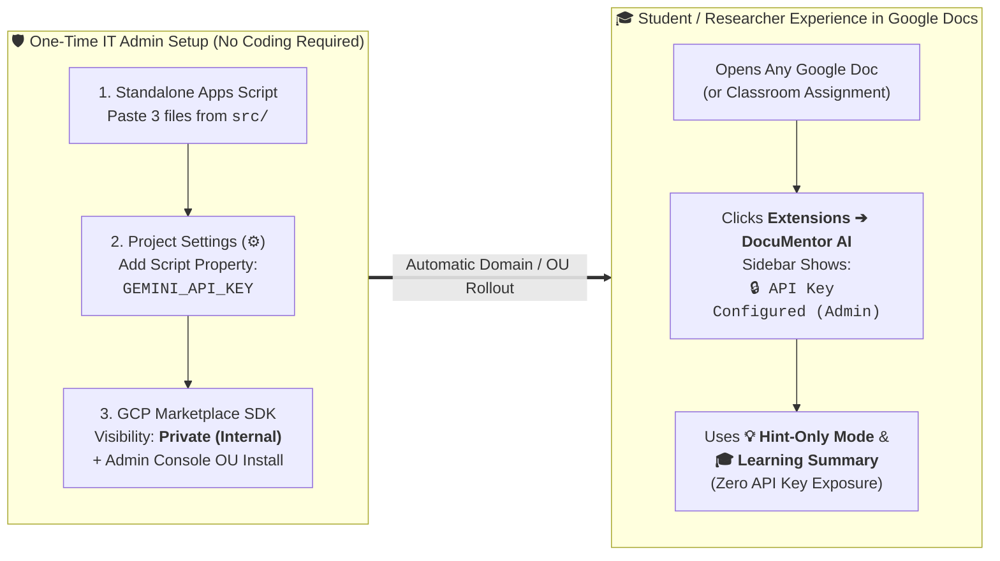

# 🏫 School, University & Organization Deployment Guide (Domain-Internal Setup)

**[⬅️ Back to Main README](README.md)** | **[👤 Looking for Personal Single-User Setup? See `INSTALL_INDIVIDUAL.md`](INSTALL_INDIVIDUAL.md)**

---

## Overview: Zero-Code Domain-Internal Deployment (`ScriptProperties` + Private Add-on)

In K–12 schools, universities, academic research laboratories, and corporate organizations using **Google Workspace for Education** or **Google Workspace (Business / Enterprise)**, two major challenges typically prevent adopting AI writing tools:
1. **Google AI Studio Is Blocked for Students / End Users:** Students (especially under-18 organizational units) cannot access Google AI Studio to generate their own Gemini API keys, and asking non-technical users to manage API keys is impractical.
2. **API Key Security & Universal Document Access:** Embedding an API key inside a shared Google Docs template exposes the script (`Extensions > Apps Script`) to anyone with edit access, and making copies of a Google Doc via Google Classroom automatically wipes `ScriptProperties`.

Starting in **`v1.0.3`** (and expanded with Google Drive RAG in **`v1.0.4`**), **DocuMentor AI** natively resolves both challenges **using the exact same single codebase—without requiring IT staff or educators to modify a single line of code**:

- **Central Admin API Key & Optional RAG Folder via GUI (`ScriptProperties`):** The IT administrator sets `GEMINI_API_KEY` (and optionally `RAG_FOLDER_ID` pointing to a shared Google Drive folder of style guides, rubrics, or coding standards) once inside the Apps Script visual interface (**Project Settings ⚙️ > Script Properties**). When `DocuMentor AI` detects these properties in `ScriptProperties`, it automatically activates **Admin-Managed Mode**:
  - End users (students, researchers, employees) never see an API key prompt.
  - The sidebar status bar displays **`🔑 API: Admin`** (and **`📚 RAG: Admin`** when `RAG_FOLDER_ID` is set) and hides the **Reset / Clear** buttons so users cannot accidentally clear or overwrite the organization's settings.
  - The raw API key string and admin folder ID are never sent to the client browser.
- **Private (Domain-Only) Google Workspace Marketplace Add-on:** By publishing the script as a **Private (Internal)** Editor Add-on within your Google Workspace domain:
  - **100% Isolated from Student Inspection:** Because the script runs as a standalone add-on rather than being attached to a shared document, students cannot open `Extensions > Apps Script` to view the code or extract the API key.
  - **Works on Every Google Document:** Students and faculty can launch **DocuMentor AI** from **Extensions > DocuMentor AI > Open Dashboard** on any new or existing Google Doc (including Google Classroom assignments).
  - **No Google Public Review Wait Time:** Private domain-only apps bypass public Marketplace verification and become active within your school/organization domain immediately.

---

## Prerequisites for IT Administrators

Before starting the 3-step setup below, ensure the following prerequisites are met:

1. **Google Workspace Domain Environment:**
   - Your institution uses **Google Workspace for Education** (Fundamentals, Standard, or Plus) or **Google Workspace Business / Enterprise** with a custom domain (e.g., `@school.edu`, `@university.ac.jp`, `@company.com`).
2. **IT Administrator Account Permissions:**
   - Access to [Google Apps Script](https://script.google.com/) and [Google Cloud Console](https://console.cloud.google.com/) to create **1 standard GCP project** for hosting the internal add-on.
   - Access to the [Google Workspace Admin Console](https://admin.google.com/) to install the private add-on across the domain or specific student/faculty Organizational Units (OUs).
3. **One Organization-Managed Gemini API Key (Paid Tier / Cloud Billing Recommended):**
   - **Students do NOT need access to Google AI Studio.** Only the IT administrator (an adult/admin account) needs to generate **one** Gemini API key from [Google AI Studio](https://aistudio.google.com/) or the GCP `Generative Language API`.
   - **Why Linking Cloud Billing (Paid Tier 1+) Is Strongly Recommended for Classrooms & Labs:**
     - **Concurrent Classroom Rate Limits:** The Free Tier of the Gemini API has strict requests-per-minute (RPM) limits. If 30–40 students click **🚀 Run Proofreading** simultaneously during a class session, a Free Tier key will hit `HTTP 429` quota errors. Linking a Cloud Billing account (Pay-as-you-go Tier 1+) unlocks high concurrent rate limits for smooth classroom usage.
     - **Student & Research Data Privacy Guarantee:** Under Google's Gemini API Terms of Service, prompts and manuscripts submitted through a **Paid (billed) API project are NEVER used to train or improve Google models**, ensuring strict FERPA / GDPR / academic manuscript confidentiality.
4. **Google Apps Script Execution Quotas (Handled Per User Automatically):**
   - When deployed as a Google Workspace Editor Add-on, `UrlFetchApp.fetch` calls execute under each active student/user's own Google Workspace daily quota (20,000–100,000 calls/day per user) rather than consuming a single admin user's quota.

---

## Step-by-Step Deployment Guide for Non-Coder IT Staff

### Phase 1: Create the Standalone Apps Script Project & Set `ScriptProperties` (5 Minutes)

1. Sign in with your IT Administrator account and open **[Google Apps Script (script.google.com)](https://script.google.com/)**.
2. Click **➕ New project** at the top-left, click **Untitled project** at the top, and rename it to **`DocuMentor AI`**.
3. **Enable `appsscript.json`:**
   - Click **Project Settings** (the gear icon ⚙️ on the left sidebar).
   - Check the box **✅ "Show 'appsscript.json' manifest file in editor"**.
4. **Paste the 3 Repository Files (Zero Modifications Needed):**
   - Click **Editor** (`< >` icon on the left sidebar).
   - Select **`appsscript.json`** and replace its contents with **[`src/appsscript.json`](src/appsscript.json)**.
   - Select **`Code.gs`** and replace its contents with **[`src/code.js`](src/code.js)**.
   - Click **`+`** next to **Files** > **HTML**, name the file **`index`** (it will appear as `index.html`), and paste the contents of **[`src/index.html`](src/index.html)**.
   - Click **Save project** (💾) or press `Ctrl + S` / `Cmd + S`.
5. **Register the Shared Gemini API Key (and Optional Google Drive RAG Folder) in `ScriptProperties` (Visual GUI):**
   - Click **Project Settings** (the gear icon ⚙️ on the left sidebar) again.
   - Scroll down to the **Script Properties** section at the bottom and click **Add script property**.
   - Enter the exact property name and your organization's Gemini API key:
     - **Property:** `GEMINI_API_KEY`
     - **Value:** `AIzaSy...` *(your school/organization Gemini API key)*
   - *(Optional)* To ground all users' proofreading and code reviews in a shared Google Drive folder or single file of organizational style guides, rubrics, or coding standards (`.md`, `.txt`, or Google Docs), click **Add script property** again:
     - **Property:** `RAG_FOLDER_ID`
     - **Value:** `1AbCdEf...` *(your shared Google Drive Folder/File ID or URL)*
   - Click **Save script properties**.
6. *(Optional)* In the **Project Settings (⚙️)** screen, copy the **Script ID**—you will use it in Phase 2.

---

### Phase 2: Link a Standard GCP Project & Publish as a Private Add-on (5 Minutes)

1. **Create or Select a Standard GCP Project:**
   - Open the [Google Cloud Console](https://console.cloud.google.com/) and create a new project (e.g., `documentor-ai-internal`).
   - On the GCP Project Dashboard (**Cloud Overview > Dashboard**), copy the **Project number** (a numeric string such as `123456789012`).
2. **Link the GCP Project Number to Your Apps Script Project:**
   - Return to your Apps Script **Project Settings (⚙️)** tab.
   - Under **Google Cloud Platform (GCP) Project**, click **Change project**, paste your **GCP Project number**, and click **Set project**.
3. **Create a Versioned Deployment in Apps Script:**
   - At the top-right of the Apps Script editor, click **Deploy** > **New deployment**.
   - Click the gear icon ⚙️ next to *"Select type"* and choose **Add-on**.
   - Under *New description*, type `v1.0.4` and click **Deploy**.
   - Note the **Version number** (e.g., `1`).
4. **Enable Required APIs in GCP Console:**
   - In the Google Cloud Console for your project, go to **APIs & Services > Library**.
   - Search for and click **Enable** on the following APIs:
     1. **`Google Docs API`** *(Required so `DocuMentor AI` can read/write suggestions and comments via `v1`)*
     2. **`Google Drive API`** *(Required when using Google Drive RAG Rulebook folders)*
     3. **`Google Workspace Marketplace SDK`** *(Required to publish the internal add-on)*
5. **Configure the OAuth Consent Screen as `Internal`:**
   - In the GCP Console, go to **APIs & Services > OAuth consent screen** (or **Google Auth Platform > Audience**).
   - Select **Internal** as the User Type (restricting access strictly to users within your school/organization domain).
   - Fill in the App name (`DocuMentor AI`), user support email, and developer contact email, then click **Save**.
6. **Configure the Google Workspace Marketplace SDK (`Private` Visibility):**
   - In the GCP Console, go to **APIs & Services > Enabled APIs & services > Google Workspace Marketplace SDK** and click the **App Configuration** tab:
     - **App Visibility:** Select **Private** *(ensures the add-on is visible ONLY to your school/organization domain and requires zero Google review wait time)*.
     - **Installation Settings:** Select **App can be installed by any user on the domain or by an admin** (or **Admin only** if you only want central OU installation).
     - **App Integration:** Check **✅ Docs add-on**, paste your Apps Script **Script ID** (from Phase 1, Step 6) and the **Deployment Version number** (`1` from Phase 2, Step 3).
     - **OAuth Scopes:** Add the four scopes from [`src/appsscript.json`](src/appsscript.json) in addition to the default scopes:
       - `https://www.googleapis.com/auth/documents`
       - `https://www.googleapis.com/auth/drive.readonly`
       - `https://www.googleapis.com/auth/script.container.ui`
       - `https://www.googleapis.com/auth/script.external_request`
     - Click **Save Draft**.
   - Click the **Store Listing** tab on the left, enter the application title (`DocuMentor AI`), short description, and required icon/banner placeholders, and click **Publish**.

---

### Phase 3: Install for Students / Organizational Units via Google Admin Console (2 Minutes)

1. Open the **[Google Workspace Admin Console (admin.google.com)](https://admin.google.com/)**.
2. Navigate to **Apps > Google Workspace Marketplace apps > Apps list**.
3. Click **Install app**, switch to the **Internal apps** tab, and select **DocuMentor AI**.
4. Click **Admin install**:
   - Choose **Everyone at your organization** OR select **Specific organizational units / groups** (e.g., `/Students/HighSchool`, `/Faculty`, or `/ResearchLab`).
   - Ensure the checkbox to **grant data access (pre-authorize OAuth scopes)** is enabled so students are never interrupted by an OAuth consent popup.
   - Click **Finish**.

---

## How Students, Teachers & Researchers Use the Installed Add-on

Once installed by the administrator:
1. A student, educator, or researcher opens **any Google Document** in their browser.
2. In the top menu bar, they click **Extensions** > **DocuMentor AI** > **Open Dashboard**.
3. The **DocuMentor AI** sidebar opens on the right:
   - The **⚙️ AI Engine & API Settings** card automatically shows **`🔒 API Key Configured (School / Organization Admin)`** with no API key input box and no Reset button.
   - Users can immediately toggle **💡 Hint-Only Mode** (to practice self-editing flagged sentences before checking the reference rewrite), **🎯 Proofread Selection Only**, or **📜 Include Resolved Review History**, and click **🚀 Run Proofreading** or **🎓 Generate Learning Summary from Suggestions & Comments**.

---

**[⬅️ Back to Main README](README.md)** | **[👤 View Individual Personal Setup Guide](INSTALL_INDIVIDUAL.md)**
