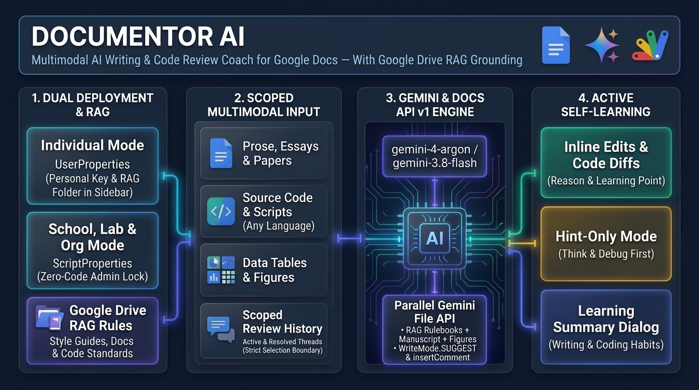

# DocuMentor AI



**AI-Powered Proofreading & Multimodal Suggestion Coach for Google Docs**

[](https://opensource.org/licenses/MIT)
[](https://developers.google.com/apps-script)
[](https://developers.google.com/workspace/docs/api/how-tos/suggestions)
[](https://ai.google.dev/)
[](https://github.com/tanaikech/DocuMentorAI)

---

## Overview

**DocuMentor AI** is a Google Docs add-on built with Google Apps Script, the Google Docs API (`v1`), and the Gemini API (`gemini-3.8-flash` / `gemini-4-argon`). Rather than overwriting a user's manuscript directly, DocuMentor AI leverages the newest [Google Docs API Suggestion & Comment Management capabilities](https://developers.google.com/workspace/docs/api/how-tos/suggestions) (`WriteControl.writeMode = "SUGGEST"`, `addCommentReply`, `insertComment`, `acceptSuggestion`, `rejectSuggestion`, and `deleteComment`) to act as an interactive, multimodal writing coach directly inside Google Docs.

It holistically analyzes **body text**, **structured tables**, and **visual figures/charts** (via multimodal image inspection), applies non-destructive inline edit suggestions, attaches educational explanations to every suggestion thread, and presents a structured **Writing Coach & Learning Summary** modal dialog with one-click clipboard copy support.

---

## Purpose, Motivation & Significance

### Purpose of Development & Addressing the "AI-Induced Cognitive Offloading" Problem

**DocuMentor AI** was developed to break away from the conventional paradigm of generative AI proofreading—which focuses solely on "efficiency by directly replacing the final text"—and instead achieve **"preserving user agency and maximizing learning outcomes."**

In recent years, "thought stopping" (cognitive offloading) and the decline of critical thinking abilities caused by over-reliance on AI have become pressing societal challenges. For example, a June 2025 brain study by the MIT Media Lab (*"Your Brain on ChatGPT"*) demonstrated the risk of **"cognitive debt,"** showing that continuously and passively accepting AI-generated outputs reduces brain activity and neural connectivity ([Ref](https://www.media.mit.edu/projects/your-brain-on-chatgpt/overview/)). Furthermore, entering 2026, research from institutions such as Carnegie Mellon University, the Wharton School (University of Pennsylvania), and MIT, along with related reports, have highlighted phenomena across education and business including the **"shortcut trap"**—where even 10 minutes of AI reliance reduces subsequent independent problem-solving and logical thinking performance by 20% ([Ref](https://japan.cnet.com/article/35247336/))—and **"cognitive surrender,"** where reading fluent AI responses creates a false illusion of understanding and leads students and professionals to stop thinking critically for themselves ([Ref](https://www.asahi.com/articles/ASVB146BHVB1UHBI03JM.html)).

**DocuMentor AI** fundamentally solves these challenges by leveraging Google Docs' native **Suggestion** and **Comment** features to **visualize the thought process and rationale (`Why`—which part was revised, how, and why)** rather than overwriting the author's text. Because the user must actively judge whether to **accept or reject** each proposed revision, critical thinking is naturally triggered instead of blindly accepting AI output. According to a survey reported by Nikkei XTECH in October 2026, the #1 concern among generative AI users (42.1%) is the **"decline in thinking ability due to AI dependency"** ([Ref](https://xtech.nikkei.com/atcl/nxt/mag/nc/18/020600010/100500235/)). By transforming AI from a mere "ghostwriter" into a **"side-by-side personal tutor,"** DocuMentor AI directly addresses this concern and empowers users to cultivate autonomous writing skills and a continuous growth mindset.

### Technical Inspiration & Background

Recently, programmatic comment and suggestion management via APIs became available across Google Docs, Sheets, and Slides, making it possible to build interactive, in-document coaching workflows.

When I read the following three recent articles by **Romin Irani** demonstrating the new Google Docs API comment and suggestion capabilities, I was inspired by the idea that these features could be harnessed not only for automated document review, but also as a **self-directed learning tool** to help writers recognize their own habits and continuously improve their writing skills:

1. [Building an AI Document Reviewer with Google ADK, Gemini, and the New Google Docs Comments](https://medium.com/google-cloud/building-an-ai-document-reviewer-with-google-adk-gemini-and-the-new-google-docs-comments-1f79fb6cb86f)
2. [Grounding Google Docs Suggested Edits with Developer Knowledge MCP and Google Search](https://medium.com/google-cloud/grounding-google-docs-suggested-edits-with-developer-knowledge-mcp-and-google-search-9e2a3bf2800e)
3. [Building an AI Comment Assistant in Google Docs with ADK and the New Docs API v1 Comment](https://medium.com/google-cloud/building-an-ai-comment-assistant-in-google-docs-with-adk-and-the-new-docs-api-v1-comment-b293aecaa92c)

At the same time, because I wanted to verify the real-world capabilities of **Gemini 4 Argon**, the **DocuMentor AI application itself was built using Gemini 4 Argon**, while also integrating `gemini-4-argon` directly into the add-on as the high-precision model for multimodal proofreading and coaching.

### Core Pillars

1. **Non-Destructive, Transparent AI Editing (`WriteMode.SUGGEST`)**
   Traditional AI writing assistants replace text directly or require copying and pasting between external chat windows and the document. By programmatically generating native Google Docs **Suggested Edits** alongside anchored comment replies (`addCommentReply`), authors retain 100% editorial control over every proposed change.
2. **True Multimodal Manuscript Understanding via the Gemini File API**
   Real-world technical reports, academic papers, and business proposals rely on the interplay between prose, tabular data, and visual charts. DocuMentor AI packages the target manuscript text and structured tables into a Markdown file alongside any embedded figures/charts (as binary image data), temporarily uploads them in parallel via the **Gemini File API**, passes their file URIs (`fileData.fileUri`) to Gemini for cross-modal consistency checks and visual improvement suggestions, and automatically deletes all temporary files from the Gemini File API immediately after content generation to maintain a clean environment and compact prompt payload even for long manuscripts.
3. **Flexible Scope Control (Entire Active Tab vs. Selection Only)**
   Authors can choose between proofreading the **entire active tab** (default) or toggling **Proofread Selection Only** to extract and upload strictly the highlighted phrase, paragraph, table cell, table, or figure—minimizing payload size and latency when focusing on a specific section.
4. **Pedagogical Writing Coach for Continuous Self-Learning (From Both AI & Other Users' Reviews)**
   Instead of functioning as a black-box proofreader, DocuMentor AI explains *why* each edit was made (`Reason`) and provides a reusable takeaway (`Learning Point`). Upon completion of AI proofreading, it automatically opens a dedicated **Writing Coach & Learning Summary** custom dialog summarizing:
   - **Overall Manuscript Evaluation (`overallFeedback`)**
   - **What Was Revised / Pointed Out (`revisionsDigest`)**
   - **Areas for Improvement & Writing Habits (`weakPointsAndHabits`)**
   - **Actionable Advice for Future Writing (`actionableTips`)**
   Furthermore, via the dedicated **🎓 Generate Learning Summary from Suggestions & Comments** button, DocuMentor AI can also generate this **Writing Coach & Learning Summary** directly from **existing suggestions and comments already present when you open a Google Document**—allowing you to learn effectively not only from AI proofreading, but also from edits and review comments left by colleagues, editors, or supervisors (and to re-generate the summary separately at any time after proofreading).

---

## Expected Impact & Use Cases

### Expected Benefits
- **Accelerated Review Cycles:** One-click **Accept All Suggestions** (`acceptSuggestion`), **Clear All Suggestions** (`rejectSuggestion`), and **Clear All Comments** (`deleteComment`) streamline bulk suggestion and comment management directly from the sidebar.
- **Iterative & Collaborative Proofreading:** Because DocuMentor AI inspects existing unresolved suggestions (`SUGGESTIONS_INLINE`), it respects pending edits and proposes non-overlapping improvements on settled text.
- **Long-Term Skill Development:** Writers internalize recurring grammatical, structural, or data-presentation habits through the post-run Learning Summary dialog, which can be copied to the clipboard with a single click for personal study notes or team feedback logs.
- **Full Bilingual Operation (`EN` / `JA`):** When English mode is selected, all UI controls, categories, reasons, and learning summaries are generated 100% in English; when Japanese mode is selected, everything is generated 100% in Japanese.

### Target Scenarios
- **Business Reports & Proposals:** Checking tone, conciseness, and numerical alignment between executive summaries, financial tables, and embedded Google Sheets charts.
- **Academic & Technical Manuscripts:** Refining logical flow, figure captions, and table clarity in multi-tab documents.
- **Language Learning & Corporate Training:** Providing writers with immediate, contextualized feedback on their writing habits without losing their original voice.
- **Overcoming Writer's Block:** Generating a clean initial draft directly into an empty tab from a custom prompt before running iterative proofreading passes.

---

## Key Features

- **4-Stage Real-Time Process Dashboard:** Visualizes each step of the pipeline (`Step 1: Fetch` ➔ `Step 2: Gemini Analysis` ➔ `Step 3: Build Payload` ➔ `Step 4: Apply Suggestions & Comments`) with live metrics and expandable details.
- **Proofreading Scope Toggle Switch:**
  - **OFF (Default):** Proofreads the entire currently active tab (text, tables, and figures/charts).
  - **ON:** Extracts and uploads only the user's current selection (`doc.getSelection()`) for fast, targeted proofreading.
- **Multimodal Table & Figure Coaching (Created as Comments):** Because inline edit suggestions (`WriteMode.SUGGEST`) cannot be applied directly to figures, DocuMentor AI creates figure/chart and overall table review feedback as anchored Google Docs comments (`insertComment`) on tables (`TABLE_1`, etc.) and figures/charts (`VISUAL_1`, etc.) with targeted structural and visual advice.
- **Learning Summary Generation from Existing Suggestions & Comments:** In addition to auto-generating the learning summary during **🚀 Run Proofreading**, the **🎓 Generate Learning Summary from Suggestions & Comments** button retrieves and analyzes both existing inline suggestions (`SuggestionThread`) and comment threads (`CommentThread`, including figure/table comments and human reviewer comments) already in the document to produce a structured **Writing Coach & Learning Summary** at any time.
- **Custom Modal Dialogs:**
  - **🎓 Writing Coach & Learning Summary Dialog:** Automatically opens upon completion of proofreading—and can also be generated on demand from existing suggestions and comments via **🎓 Generate Learning Summary from Suggestions & Comments**—displaying a structured learning digest and a **Copy to Clipboard** button.
  - **✦ About DocuMentor AI Dialog:** Opens when clicking `DocuMentor AI` in the sidebar header or footer, displaying the developer name (`Kanshi Tanaike`), version (`v1.0.1`), and GitHub repository link.

---

## Architecture & Workflow

The following Mermaid diagram illustrates the end-to-end execution workflow of **DocuMentor AI**:

```mermaid
flowchart TD
    User(["👤 User in Google Docs"]) --> Toggle{"Scope Toggle Switch"}
    Toggle -- "OFF (Default)" --> ScopeTab["📑 Target: Entire Active Tab<br/>(doc.getActiveTab)"]
    Toggle -- "ON" --> ScopeSel["🎯 Target: Selected Content Only<br/>(doc.getSelection)"]

    ScopeTab --> Step1
    ScopeSel --> Step1

    subgraph Pipeline ["🚀 4-Stage Proofreading & Coaching Pipeline"]
        direction TB
        Step1["<b>STEP 1: Fetch Document & Parse Structure</b><br/>• Call <code>documents.get</code> with <code>includeTabsContent=true</code>,<br/>  <code>suggestionsViewMode=SUGGESTIONS_INLINE</code>,<br/>  <code>commentsViewMode=COMMENTS_VIEW_MODE_INCLUDED</code><br/>• Extract Settled Text Blocks, Tables (Markdown),<br/>  Figures/Charts (Content URIs), and Existing Suggestions"]

        Step2["<b>STEP 2: Multimodal Analysis & Coaching via Gemini</b><br/>• Upload Manuscript (or Selected Excerpt) Markdown file & Figure images<br/>  in parallel via Gemini File API & pass <code>fileData.fileUri</code><br/>• Send compact prompt + File URIs to <code>gemini-3.8-flash</code> or <code>gemini-4-argon</code><br/>• Delete all uploaded temporary files immediately in <code>finally</code> block<br/>• Output structured JSON: Inline Suggestions, Element Suggestions,<br/>  and Author Learning Summary (100% EN or 100% JA)"]

        Step3["<b>STEP 3: Build Suggestion & Comment Payloads</b><br/>• Map exact text matches to UTF-16 character indices<br/>• Sort text edits in descending index order (bottom-to-top)<br/>• Construct <code>deleteContentRange</code> + <code>insertText</code> with<br/>  <code>writeControl: { writeMode: 'SUGGEST' }</code> and <code>tabId</code>"]

        Step4["<b>STEP 4: Apply Suggestions & Educational Comments</b><br/>• Execute <code>documents.batchUpdate</code> in <code>SUGGEST</code> mode<br/>• Extract <code>createdSuggestionIds</code> from <code>suggestionResponses</code><br/>• Attach Reason & Learning Point via <code>addCommentReply</code><br/>  (for text edits) and <code>insertComment</code> (for Tables/Figures)"]

        Step1 --> Step2 --> Step3 --> Step4
    end

    Step4 --> DocUI["📝 Google Docs Native Suggestion Cards<br/>(Accept / Reject Individual Edits)"]
    Step4 --> SummaryModal["🎓 Custom Modal Dialog:<br/>Writing Coach & Learning Summary<br/>(with One-Click Copy to Clipboard)"]
    DocUI --> BulkActions["⚡ Sidebar Bulk Actions:<br/>✅ Accept All Suggestions (acceptSuggestion)<br/>🧹 Clear All Suggestions (rejectSuggestion)<br/>🗑️ Clear All Comments (deleteComment)"]
```



---

## Installation & Usage Guide

Follow these steps to install and run **DocuMentor AI** in your Google Document:

### 1. Create or Open a Google Document
1. Open [Google Docs](https://docs.google.com/) and create a new document or open an existing manuscript you wish to proofread.
2. In the top menu bar, click **Extensions** > **Apps Script** to open the Google Apps Script editor.

### 2. Copy and Paste the Script Files
In the Apps Script editor, set up the following three files from the [`src/`](src/) directory of this repository:

1. **Enable `appsscript.json` (Manifest File):**
   - In the Apps Script editor, click **Project Settings** (the gear icon ⚙️ on the left sidebar) and check the box **"Show 'appsscript.json' manifest file in editor"**.
   - Return to the **Editor** (`< >` icon), select `appsscript.json`, and replace its contents with [`src/appsscript.json`](src/appsscript.json).
2. **Copy `code.js` into `Code.gs`:**
   - Select the default `Code.gs` file in the editor and replace its entire contents with [`src/code.js`](src/code.js).
3. **Create `index.html`:**
   - Click the **`+`** button next to **Files** in the left panel and select **HTML**.
   - Name the file **`index`** (it will appear as `index.html`—do not type `.html` in the name prompt).
   - Paste the entire contents of [`src/index.html`](src/index.html) into this file.
4. **Save the Project:**
   - Press `Ctrl + S` (or `Cmd + S` on macOS) or click the **Save project** (floppy disk 💾) icon.

### 3. Reload Google Docs & Launch from Custom Menu
1. Close the Apps Script tab and **reload (refresh) your Google Docs browser tab**.
2. After a few seconds, a new custom menu **`✦ DocuMentor AI`** will appear in the Google Docs menu bar.
3. Click **`✦ DocuMentor AI`** > **`Open Dashboard`**.
4. *(First-time run only)* Google will prompt you to authorize the script permissions (`documents`, `script.container.ui`, `script.external_request`). Complete the authorization flow and click **`✦ DocuMentor AI`** > **`Open Dashboard`** again.

### 4. Configure & Run Proofreading (How to Use the Sidebar)
1. **First, Register Your Gemini API Key:**
   - When you launch the application and the sidebar opens, **first register your API key for using Gemini**. Enter your **Gemini API Key** (obtainable from [Google AI Studio](https://aistudio.google.com/)) in the **API & Model Settings** card and click **Save** (it is stored securely in `PropertiesService.getUserProperties()`).
   - You can also choose your preferred model (`gemini-3.8-flash` for fast daily proofreading or `gemini-4-argon` for high-precision analysis) and toggle the display/output language between **`EN`** (English) and **`JA`** (Japanese) at the top-right of the sidebar.
2. **Switch the Proofreading Scope (`"Proofread Selection Only"` Toggle):**
   - Turning **ON** the **"🎯 Proofread Selection Only"** toggle switch proofreads **only the selected part** (specific text, table cells, tables, or figures highlighted in the document).
   - Leaving the **"🎯 Proofread Selection Only"** toggle switch **OFF** (default) proofreads the **entire active tab** (text, tables, and figures).
3. **Add Additional Instructions via Custom Prompt (Optional):**
   - When proofreading, it is also possible to add additional instructions as a **Custom Prompt** by typing into the Custom Prompt box or clicking the preset prompt chips (e.g., `#Concise & Logical`, `#Business Tone`, `#Tables & Charts`, `#Grammar & Flow`).
4. **Execute Proofreading (`"Run Proofreading"`) & Automatic Learning Summary:**
   - Click **🚀 Run Proofreading (Suggest & Coach)** (or **📝 Generate Initial Text from Prompt** if the tab is currently empty).
   - When the 4-step pipeline finishes, the **🎓 Writing Coach & Learning Summary** custom dialog automatically pops up. Click **📋 Copy to Clipboard** to save your personalized writing advice.
5. **Generate a Learning Summary from Existing Suggestions & Comments (Learn from Other Users' Feedback too):**
   - Click the **"🎓 Generate Learning Summary from Suggestions & Comments"** button to analyze **existing suggestions and comments** already present when you open a Google Document. This allows you to synthesize a **Writing Coach & Learning Summary** from edits and comments made by other users (colleagues, supervisors, or human editors) so you can learn from human peer reviews as well.
   - Note that while pressing **"🚀 Run Proofreading"** automatically generates the **Writing Coach & Learning Summary**, you can also press **"🎓 Generate Learning Summary from Suggestions & Comments"** separately at any time afterward to re-run and generate a fresh summary from the current suggestions and comments in the document.
6. **Accept or Delete All Suggestions & Comments with One Click:**
   - Clicking the **"✅ Accept All Suggestions"** button accepts all pending inline suggestions in the active tab at once.
   - Clicking the **"🧹 Clear All Suggestions"** button rejects and clears all pending inline suggestions in the active tab at once.
   - Clicking the **"🗑️ Clear All Comments"** button deletes all active comments (including figure/table review comments created via `insertComment`) in the active tab at once.
   - *(Tip)* Click **`DocuMentor AI ⓘ`** in the sidebar header or footer at any time to open the **About DocuMentor AI** custom dialog showing developer, version, and repository details.

---

## Testing with the Sample Manuscript (`sample/`)

A ready-to-use multimodal test manuscript is provided in the [`sample/`](sample/) directory so you can immediately evaluate **DocuMentor AI** across body text, a structured table, and an embedded figure/chart:

- **[`sample/sample_article.md`](sample/sample_article.md):** Contains an introductory draft about Google Apps Script (GAS) and Gemini AI integration that intentionally includes redundant phrasing, colloquialisms, and grammatical awkwardness (e.g., *"most biggest advantage"*, *"boring daily routine works"*, *"special softwares"*), along with a compact 2-data-row (3 rows including the header) Markdown comparison table and a reference to [`sample/sample_figure.png`](sample/sample_figure.png) sized to fit neatly on a single page.
- **[`sample/sample_figure.png`](sample/sample_figure.png):** A composite diagram and bar chart (*"Figure 1: GAS Automation Architecture & Daily Task Time Comparison"*) designed for multimodal visual inspection.

### How to Load the Sample into Google Docs
1. **Import or Paste the Markdown Content:**
   - **Option A (Paste from Markdown):** Copy the contents of [`sample/sample_article.md`](sample/sample_article.md), right-click inside your Google Doc, and select **Paste from Markdown** (available in Google Docs when *"Enable Markdown"* is turned on under **Tools** > **Preferences**), or paste the text and create the table directly.
   - **Option B (Open in Google Drive):** Upload [`sample/sample_article.md`](sample/sample_article.md) to Google Drive and open it with Google Docs.
2. **Insert the Sample Figure:**
   - Place your cursor right below the table, click **Insert** > **Image** > **Upload from computer**, and select [`sample/sample_figure.png`](sample/sample_figure.png).
3. **Test Both Proofreading Modes:**
   - **Full Active Tab Mode (Toggle OFF):** Leave **🎯 Proofread Selection Only** turned **OFF** and click **🚀 Run Proofreading (Suggest & Coach)** to see inline text edits, table cell refinements, anchored comments on `TABLE_1` and `VISUAL_1`, and the pop-up **🎓 Writing Coach & Learning Summary** dialog.
   - **Selection-Only Mode (Toggle ON):** Click **🧹 Clear All Suggestions** (and **🗑️ Clear All Comments**), highlight a single paragraph, table cell, or the figure, switch **🎯 Proofread Selection Only** **ON**, and run proofreading again to verify scoped suggestions and comments.

### Example Output: "Writing Coach & Learning Summary" from the `sample/` Manuscript

When you run **DocuMentor AI** on the [`sample/`](sample/) manuscript ([`sample/sample_article.md`](sample/sample_article.md) + [`sample/sample_figure.png`](sample/sample_figure.png)), the **🎓 Writing Coach & Learning Summary** dialog automatically appears upon completion with a one-click **📋 Copy to Clipboard** button, providing the following structured pedagogical feedback:

```text
[🎓 Writing Coach & Learning Summary (DocuMentor AI v1.0.0)]

■ 📋 Overall Manuscript Evaluation
This introductory guide to Google Apps Script (GAS) clearly communicates the core value proposition of the platform, including its ease of setup, integration with Google Workspace, and connection to the Gemini AI API. However, the body text currently contains several grammatical errors, redundant modifiers, and overly conversational phrases (e.g., "most biggest," "many various," "softwares"). Furthermore, while Figure 1 and Table 1 present compelling time-saving metrics (reducing manual work from 120 minutes to 30 and 5 minutes), the body text never explicitly references the table or figure, nor does Table 1 include the 120-minute manual baseline shown in the chart. Aligning your text, table, and visual data while tightening your prose will significantly elevate the professionalism of this document.

■ 🛠️ What Was Revised
Revisions focused on eliminating redundant modifiers and conversational filler, correcting grammatical errors (such as double superlatives and uncountable nouns), improving sentence flow, and aligning the data terminology across the body text, Table 1, and Figure 1.

■ 🔍 Areas for Improvement & Writing Habits
The draft exhibits a habit of stacking redundant intensifiers ("most biggest," "many various," "totally do not... at all"), using uncountable nouns in the plural form ("softwares," "routine works"), and translating idiomatic structures directly into English ("There is a merit that...", "is very recommended"). Additionally, visual and tabular data are dropped into the document without being cited in the narrative or fully synchronized with one another.

■ 🌱 Actionable Advice for Future Writing
1. Avoid pairing superlatives or similar adjectives together (use "biggest" instead of "most biggest," and "various" instead of "many various"). 2. Remember that nouns like "software" and "work" (when meaning labor/tasks) are uncountable in English and do not take an "-s." 3. Always introduce and interpret your tables and figures in the body text, ensuring that baselines and labels match across all elements.
```

Rather than only showing line-by-line edits, this summary promotes effective self-learning by helping authors recognize their recurring linguistic habits (e.g., stacking redundant intensifiers like `"most biggest"` and `"many various"`, uncountable noun mistakes like `"softwares"` and `"routine works"`, and direct-translation structures like `"There is a merit that..."`), teaching cross-modal document literacy (explicitly citing `Table 1` and `Figure 1` in the body text and synchronizing the `120-minute` manual baseline and labels across prose, tables, and charts), and providing a portable 3-point checklist for future writing.

---

## Project Structure

```text
DocuMentorAI/
├── README.md                                       # Comprehensive documentation and usage guide
├── images/
│   └── documentor_ai_overview_infographic.png      # Visual architecture & feature overview infographic
├── sample/
│   ├── sample_article.md                           # Sample manuscript (text + table + figure link) for testing
│   └── sample_figure.png                           # Sample architecture diagram & bar chart for multimodal testing
└── src/
    ├── appsscript.json                             # Apps Script manifest (Docs Advanced Service v1 & OAuth scopes)
    ├── code.js                                     # Backend logic (Docs API v1 parsing, Gemini API, batchUpdate, dialogs)
    └── index.html                                  # Sidebar dashboard UI, bilingual I18N, and 4-step pipeline controller
```

---

## Version History

- **v1.0.1**
  - Updated Step 2 to upload the target manuscript text and tables as a Markdown file (`text/markdown`) via the **Gemini File API** alongside any embedded figures/charts in parallel (`UrlFetchApp.fetchAll`), referencing all manuscript and visual assets via `fileData.fileUri` and deleting them in the `finally` block to keep the `generateContent` prompt payload compact even for large documents.
  - Updated **Proofread Selection Only** mode to extract and upload strictly the selected portion (selected text blocks, tables, and figures) rather than the entire tab.
  - Optimized client-server payload transfer between the sidebar UI and Apps Script backend.

- **v1.0.0** (Initial Release)
  - Implemented 4-stage proofreading pipeline using Google Docs API `v1` (`SUGGESTIONS_INLINE`, `COMMENTS_VIEW_MODE_INCLUDED`, `WriteMode.SUGGEST`, `addCommentReply`, `insertComment`, `acceptSuggestion`, `rejectSuggestion`, `deleteComment`).
  - Added multimodal analysis of body text, structured tables, and inline/positioned figures and charts using Gemini (`gemini-3.8-flash` and `gemini-4-argon`), uploading figure images via the **Gemini File API**, referencing their file URIs (`fileData.fileUri`), and automatically deleting the temporary files immediately after content generation.
  - Added **Proofread Selection Only** toggle switch supporting both full active-tab proofreading (default) and selection-scoped proofreading (`doc.getSelection()`) with `tabId`-aware requests.
  - Added **🎓 Writing Coach & Learning Summary** custom modal dialog with one-click **Copy to Clipboard** functionality—automatically generated after AI proofreading (`🚀 Run Proofreading`) and also executable on demand from existing suggestions and comments by other users (`🎓 Generate Learning Summary from Suggestions & Comments`).
  - Added **✦ About DocuMentor AI** custom modal dialog triggered by clicking `DocuMentor AI` in the sidebar.
  - Full bilingual (`EN` / `JA`) user interface and AI output enforcement.

---

## Author

- **Developer:** [Kanshi Tanaike](https://github.com/tanaikech)
- **GitHub Repository:** [https://github.com/tanaikech/DocuMentorAI](https://github.com/tanaikech/DocuMentorAI)
