# DocuMentor AI


**AI-Powered Multimodal Proofreading, Code Review & Self-Learning Suggestion Coach for Google Docs — Built for Individuals, Classrooms, Academic Research Labs, Engineers & Organizations**

[](https://opensource.org/licenses/MIT)
[](https://developers.google.com/apps-script)
[](https://developers.google.com/workspace/docs/api/how-tos/suggestions)
[](https://ai.google.dev/)
[](https://github.com/tanaikech/DocuMentorAI)

---

## Overview

**DocuMentor AI (`v1.0.3`)** is an open-source Google Docs add-on built with Google Apps Script, the Google Docs API (`v1`), and the Gemini API (`gemini-3.8-flash` / `gemini-4-argon`). Rather than overwriting a user's manuscript directly, DocuMentor AI leverages the newest [Google Docs API Suggestion & Comment Management capabilities](https://developers.google.com/workspace/docs/api/how-tos/suggestions) (`WriteControl.writeMode = "SUGGEST"`, `addCommentReply`, `insertComment`, `acceptSuggestion`, `rejectSuggestion`, and `deleteComment`) to act as an interactive, multimodal writing coach directly inside Google Docs.

It holistically analyzes **body text**, **structured tables**, **visual figures/charts** (via multimodal image inspection), and **active + resolved review history**, applies either non-destructive inline edit suggestions or **💡 Hint-Only coaching comments**, attaches educational explanations to every review thread, and presents a structured **Writing Coach & Learning Summary** modal dialog with one-click clipboard copy support.

With **`v1.0.3`**, a **single unified codebase** seamlessly supports **two deployment modes** with automatic detection:
1. **👤 Individual Mode (`UserProperties`):** Personal, zero-GCP-setup installation inside any Google Doc where you save your own Gemini API key in the sidebar.
2. **🏫 School, University, Academic Lab & Organization Mode (`ScriptProperties` + Private Marketplace Add-on):** Zero-code IT Administrator setup where a single organization-managed Gemini API key is configured in Apps Script **Project Settings (⚙️) > Script Properties** and deployed as a **Private (Domain-Internal) Google Workspace Marketplace Add-on**—enabling students, researchers, and staff to use DocuMentor AI across any document without ever needing Google AI Studio or seeing the API key.

---

## 🚀 Choose Your Installation Guide

Select the installation guide that matches your environment:

| Deployment Mode | Target Audience | API Key Management | Detailed Step-by-Step Guide |
| :--- | :--- | :--- | :--- |
| **👤 Individual / Personal Mode** | Independent writers, researchers, engineers, students, and bloggers setting up DocuMentor AI for their own personal use. | **Sidebar UI (`UserProperties`)**<br/>Paste your own Gemini API key directly in the sidebar (saved privately to your account). | **[📖 Open Individual Installation Guide (`INSTALL_INDIVIDUAL.md`)](INSTALL_INDIVIDUAL.md)** |
| **🏫 School, University & Organization Mode** | K–12 schools, universities, academic research labs, and companies deploying DocuMentor AI across a Google Workspace domain. | **Admin GUI (`ScriptProperties`)**<br/>IT Admin sets `GEMINI_API_KEY` once in Apps Script Project Settings (⚙️). Students/users never need AI Studio or an API key. | **[📖 Open School & Organization Deployment Guide (`INSTALL_ORGANIZATION.md`)](INSTALL_ORGANIZATION.md)** |

---

## Purpose, Motivation & Significance

### 1. Addressing the "AI-Induced Cognitive Offloading" Problem
**DocuMentor AI** was developed to break away from the conventional paradigm of generative AI proofreading—which focuses solely on "efficiency by directly replacing the final text"—and instead achieve **"preserving user agency and maximizing learning outcomes."**

In recent years, "thought stopping" (cognitive offloading) and the decline of critical thinking abilities caused by over-reliance on AI have become pressing societal challenges:
- **Cognitive Debt (MIT Media Lab, June 2025):** Demonstrated in *"Your Brain on ChatGPT"* that continuously and passively accepting AI-generated outputs reduces brain activity and neural connectivity ([Ref](https://www.media.mit.edu/projects/your-brain-on-chatgpt/overview/)).
- **The "Shortcut Trap" & "Cognitive Surrender" (CMU, Wharton School, MIT, 2026):** Showed that even 10 minutes of passive AI reliance reduces subsequent independent problem-solving and logical thinking performance by 20% ([Ref](https://japan.cnet.com/article/35247336/)), and that reading fluent AI responses creates a false illusion of understanding that leads students and professionals to stop thinking critically for themselves ([Ref](https://www.asahi.com/articles/ASVB146BHVB1UHBI03JM.html)).
- **User Anxiety Over Declining Thinking Skills (Nikkei XTECH Survey, October 2026):** Reported that the #1 concern among generative AI users (42.1%) is the **"decline in thinking ability due to AI dependency"** ([Ref](https://xtech.nikkei.com/atcl/nxt/mag/nc/18/020600010/100500235/)).

**DocuMentor AI** fundamentally solves these challenges by leveraging Google Docs' native **Suggestion** and **Comment** features to **visualize the thought process and rationale (`Why`—which part was revised, how, and why)** rather than overwriting the author's text. Furthermore, with **💡 Hint-Only Mode**, the AI withholds the rewritten sentence on the document canvas and anchors only the diagnostic issue and coaching hint as a comment—prompting learners and researchers to actively revise their own prose before checking the reference rewrite.

### 2. Empowering K–12 Education, Higher Education, Academic Research & Software Engineering Training
Across schools, universities, academic laboratories, and engineering teams, **DocuMentor AI (`v1.0.3`)** addresses critical pedagogical, scholarly, and developer workflows:
- **K–12 & University Classrooms (Safe, Zero-Key Student Access):** In **Google Workspace for Education**, access to Google AI Studio is often restricted for student Organizational Units (OUs). By allowing IT admins to configure a single school-managed API key in `ScriptProperties` and publish DocuMentor AI as a **Private (Domain-Only) Marketplace Add-on**, students can practice active-recall writing on any Google Classroom assignment with zero exposure to the underlying API key.
- **Academic Manuscripts, Theses & Lab Reports (Cross-Modal Consistency):** Scientific papers, grant proposals, and dissertations depend on strict alignment between narrative claims, statistical tables (`TABLE_1`, etc.), and figures/charts (`VISUAL_1`, etc.). DocuMentor AI visually inspects embedded figures via the **Gemini File API**, checks whether baselines, units, and axis labels match the prose and tables, and anchors constructive peer-review comments directly onto figures and tables.
- **Synthesizing Co-Author, Advisor & Peer Reviewer Feedback:** Academic writing is highly collaborative. Using **📜 Include Resolved Review History** and **🎓 Generate Learning Summary from Suggestions & Comments**, graduate students and researchers can distill dozens of inline edits and comments from advisors, co-authors, or internal lab reviewers—even after those threads have been accepted, rejected, or resolved—into a permanent, copyable study guide.
- **Multi-Language Interactive Code Review & Script Learning (Overcoming "Vibe Coding"):** Beyond natural-language prose, DocuMentor AI can be used to review and learn programming scripts written in **any programming language** (such as Python, JavaScript, TypeScript, Go, Java, C++, Rust, SQL, Bash, or Google Apps Script) pasted into Google Docs. Because each line of code is extracted as an independent block (`editableBlocks`) and updated in reverse character-index order via `WriteMode.SUGGEST`, DocuMentor AI performs **GitHub-style line-by-line inline code reviews**—crossing out buggy or insecure lines, proposing runnable idiomatic replacements, attaching `addCommentReply` explanations of *what* was wrong, *why* it fails, and *how* to fix it, and even verifying whether implementation code matches an embedded architecture diagram (`Figure 1`) or API specification table (`Table 1`).

### 3. Technical Inspiration & Background
Recently, programmatic comment and suggestion management via APIs became available across Google Docs, Sheets, and Slides. When I read the following three insightful articles by **Romin Irani** demonstrating the new Google Docs API comment and suggestion capabilities, I was inspired by the idea that these features could be harnessed not only for automated document review, but also as a **self-directed learning environment**:

1. [Building an AI Document Reviewer with Google ADK, Gemini, and the New Google Docs Comments](https://medium.com/google-cloud/building-an-ai-document-reviewer-with-google-adk-gemini-and-the-new-google-docs-comments-1f79fb6cb86f)
2. [Grounding Google Docs Suggested Edits with Developer Knowledge MCP and Google Search](https://medium.com/google-cloud/grounding-google-docs-suggested-edits-with-developer-knowledge-mcp-and-google-search-9e2a3bf2800e)
3. [Building an AI Comment Assistant in Google Docs with ADK and the New Docs API v1 Comment](https://medium.com/google-cloud/building-an-ai-comment-assistant-in-google-docs-with-adk-and-the-new-docs-api-v1-comment-b293aecaa92c)

At the same time, because I wanted to verify the real-world capabilities of **Gemini 4 Argon**, the **DocuMentor AI application itself was built using Gemini 4 Argon**, while also integrating `gemini-4-argon` directly into the add-on as the high-precision model for multimodal proofreading and coaching.

- **Published Article (Part 1):** [Building a Multimodal, Suggestion-Based AI Writing Coach with Gemini and Google Docs](https://medium.com/google-cloud/building-a-multimodal-suggestion-based-ai-writing-coach-with-gemini-and-google-docs-ea07244fed99)

---

## Core Pillars & Key Features

### Five Core Pillars
1. **Unified Dual-Mode Deployment (`UserProperties` for Individuals / `ScriptProperties` for Schools & Organizations)**
   A single script automatically detects whether an administrator has registered `GEMINI_API_KEY` in `ScriptProperties`. If present, it locks the sidebar into **Admin-Managed Mode** (`🔒 API Key Configured (School / Organization Admin)`) and hides the Reset button; if not, it operates in standard **Individual Mode** (`UserProperties`) where users save their own key via the sidebar UI. Both personal container-bound menus (`createMenu`) and domain-wide Marketplace Add-on menus (`createAddonMenu` / `onInstall`) are natively supported.
2. **Non-Destructive, Transparent AI Editing (`WriteMode.SUGGEST`) & Hint-Only Coaching Mode (`insertComment`)**
   Authors retain 100% editorial control over every proposed inline edit (`WriteMode.SUGGEST` + `addCommentReply`). Toggling on **💡 Hint-Only Mode (Comment Without Rewrite)** anchors only the diagnostic issue and coaching hint as a Google Docs comment (`insertComment`) without proposing an inline rewrite—encouraging writers to revise the sentence themselves first before expanding `👁️ Show Reference Rewrite` in the sidebar.
3. **True Multimodal Manuscript Understanding via the Gemini File API**
   DocuMentor AI packages the target manuscript text and structured tables into a Markdown file alongside any embedded figures/charts (as binary image data), temporarily uploads them in parallel via the **Gemini File API** (`UrlFetchApp.fetchAll`), passes their file URIs (`fileData.fileUri`) to Gemini for cross-modal consistency checks, and automatically deletes all temporary files in the `finally` block immediately after generation.
4. **Flexible Scope Control (Entire Active Tab vs. Selection Only)**
   Authors can proofread the **entire active tab** (default) or toggle **🎯 Proofread Selection Only** to extract and upload strictly the highlighted phrase, paragraph, table cell, table, or figure (`doc.getSelection()`).
5. **Pedagogical Writing Coach for Continuous Self-Learning (From Active & Resolved Review History)**
   Upon completion of proofreading—or on demand via **🎓 Generate Learning Summary from Suggestions & Comments**—DocuMentor AI synthesizes active suggestions, open comments, and (when **📜 Include Resolved Review History** is ON) resolved comments (`RESOLVED`) and accepted/rejected suggestions (`ACCEPTED` / `REJECTED`) into a structured **Writing Coach & Learning Summary** modal dialog:
   - **📋 Overall Manuscript Evaluation (`overallFeedback`)**
   - **🛠️ What Was Revised / Pointed Out (`revisionsDigest`)**
   - **🔍 Areas for Improvement & Writing Habits (`weakPointsAndHabits`)**
   - **🌱 Actionable Advice for Future Writing (`actionableTips`)**

### Feature Highlights
- **📊 4-Stage Real-Time Process Dashboard:** Visualizes `Step 1: Fetch` ➔ `Step 2: Gemini Analysis` ➔ `Step 3: Build Payload` ➔ `Step 4: Apply Suggestions & Comments` with live metrics and expandable details.
- **3 Interactive Control Toggle Switches:**
  - **🎯 Proofread Selection Only** (`OFF`: Entire Active Tab / `ON`: Selected Content Only)
  - **💡 Hint-Only Mode (Comment Without Rewrite)** (`OFF`: Suggest Mode + Replies / `ON`: Coaching Hint Comments + Collapsible Reference Rewrite)
  - **📜 Include Resolved Review History** (`OFF`: Active Reviews Only / `ON`: Active + Resolved/Accepted/Rejected Reviews)
- **📜 Collapsible Resolved Review History Ledger (Step 1):** Displays each historical thread's status badge (`RESOLVED`, `ACCEPTED`, `REJECTED`), reviewer name, anchor snippet, and comment/reply text.
- **🖼️ Multimodal Table & Figure Coaching (`insertComment`):** Attaches anchored Google Docs comments directly onto tables (`TABLE_1`, etc.) and figures/charts (`VISUAL_1`, etc.) with automatic 3-tier anchor range fallback.
- **⚡ One-Click Bulk Management:** **✅ Accept All Suggestions** (`acceptSuggestion`), **🧹 Clear All Suggestions** (`rejectSuggestion`), and **🗑️ Clear All Comments** (`deleteComment`).
- **🌐 Full Bilingual Operation (`EN` / `JA`):** Switches both the UI and 100% of Gemini's generated categories, reasons, and learning summaries between English and Japanese.

### Model Selection Guide: `Gemini 3.8 Flash` vs. `Gemini 4 Argon`

In the sidebar's **⚙️ AI Engine & API Settings** panel, you can switch between **`gemini-3.8-flash (Fast & Balanced)`** and **`gemini-4-argon (High Precision)`** at any time. Use the following decision matrix to select the optimal model for your proofreading or code review task:

| Scenario / Use Case | Domain | Recommended Model | Why & Key Selection Criteria |
| :--- | :--- | :--- | :--- |
| **1. Typo, Spelling & Grammar Check** | ✍️ Prose | **⚡ `Gemini 3.8 Flash`**<br/>*(Fast & Balanced)* | Fixing typos, spelling mistakes, and clear grammatical errors relies primarily on pattern recognition—making Flash's high speed and low token cost the optimal choice. |
| **2. Routine Code Refactoring** | 💻 Code | **⚡ `Gemini 3.8 Flash`**<br/>*(Fast & Balanced)* | Standardizing naming conventions, adding comments/docstrings, and rewriting simple functions without complex algorithmic changes complete almost instantaneously with Flash. |
| **3. Rapid Iterative Drafting & Interactive Checks** | ✍️ Prose / 💻 Code | **⚡ `Gemini 3.8 Flash`**<br/>*(Fast & Balanced)* | When actively drafting or iterating in the editor and wanting fast, rhythmic feedback or brainstorming without breaking your creative flow, Flash's ultra-low latency provides a stress-free experience. |
| **4. First-Pass Triage of Large Documents or Long Scripts** | ✍️ Prose / 💻 Code | **⚡ `Gemini 3.8 Flash`**<br/>*(Fast & Balanced)* | Ideal for cost-effectively screening long manuscripts or large scripts to surface broad errors and recurring issues in a single initial pass. |
| **5. Logical Consistency in Academic Papers, Contracts & Multimodal Figures** | ✍️ Prose & 🖼️ Visuals | **🧠 `Gemini 4 Argon`**<br/>*(High Precision)* | Best when deep contextual reasoning is required to detect contradictions across claims, flawed logical progressions, subtle loopholes in legal/contractual phrasing, or cross-modal mismatches between body text, tables, and figures. |
| **6. Complex Algorithm & Data Structure Review** | 💻 Code | **🧠 `Gemini 4 Argon`**<br/>*(High Precision)* | Shines in code reviews that require deep analytical thinking—such as optimizing time and space complexity, designing advanced data structures, and verifying subtle edge-case bugs. |
| **7. Security Auditing & Vulnerability Detection** | 💻 Code | **🧠 `Gemini 4 Argon`**<br/>*(High Precision)* | Ideal for deeply tracing execution paths to uncover concurrency bugs (race conditions), injection vulnerabilities, credential exposure, or subtle security flaws hidden in source code. |
| **8. Nuanced Tone, Style & Psychological Audience Adaptation** | ✍️ Prose | **🧠 `Gemini 4 Argon`**<br/>*(High Precision)* | Powerful for executing abstract, high-level editorial instructions beyond surface proofreading—such as rewriting text to achieve a specific psychological effect or persuasive tone tailored to a target audience. |

> **💡 Practical Two-Pass Workflow Tip:** For long academic papers or complex scripts, start with **`gemini-3.8-flash`** for a fast, low-cost **First-Pass Triage** (cleaning up typos, basic grammar, and naming conventions), and then switch to **`gemini-4-argon`** for your **Deep Second Pass** (verifying thesis/contract logic, cross-checking `Table 1` and `Figure 1`, or auditing algorithm complexity and security vulnerabilities).

---

## Architecture & Workflow

The following Mermaid diagram illustrates the end-to-end architecture and execution workflow of **DocuMentor AI (`v1.0.3`)**:

```mermaid
flowchart TD
    subgraph DeployMode ["🔐 Dual Deployment & API Key Resolution (v1.0.3)"]
        direction LR
        AdminMode["🏫 <b>School / Org / Lab Mode</b><br/>Private Marketplace Add-on<br/>Key in <code>ScriptProperties</code> (Locked)"]
        IndivMode["👤 <b>Individual Mode</b><br/>Container-Bound Script<br/>Key in <code>UserProperties</code> (Sidebar UI)"]
    end

    DeployMode --> User(["👤 Author / Student / Researcher in Google Docs"])
    User --> Toggle{"Scope & Mode Toggles"}
    Toggle -- "Scope: OFF (Default)" --> ScopeTab["📑 Target: Entire Active Tab<br/>(doc.getActiveTab)"]
    Toggle -- "Scope: ON" --> ScopeSel["🎯 Target: Selected Content Only<br/>(doc.getSelection)"]

    ScopeTab --> Step1
    ScopeSel --> Step1

    subgraph Pipeline ["🚀 4-Stage Proofreading & Coaching Pipeline (v1.0.3)"]
        direction TB
        Step1["<b>STEP 1: Fetch Document & Parse Structure</b><br/>• Call <code>documents.get</code> with <code>includeTabsContent=true</code>,<br/>  <code>suggestionsViewMode=SUGGESTIONS_INLINE</code>,<br/>  <code>commentsViewMode=COMMENTS_VIEW_MODE_INCLUDED</code><br/>• Extract Settled Text Blocks, Tables (Markdown), Figures/Charts,<br/>  Active Suggestions/Comments, and Resolved Review History"]

        Step2["<b>STEP 2: Multimodal Analysis & Coaching via Gemini</b><br/>• Upload Manuscript (or Selected Excerpt) Markdown file & Figure images<br/>  in parallel via Gemini File API & pass <code>fileData.fileUri</code><br/>• Include Active + (Optional) Resolved Review History in context<br/>• Delete all uploaded temporary files immediately in <code>finally</code> block<br/>• Output structured JSON: Inline/Hint Suggestions, Element Suggestions,<br/>  and Author Learning Summary (100% EN or 100% JA)"]

        Step3["<b>STEP 3: Build Suggestion or Hint-Comment Payloads</b><br/>• Map exact text matches to UTF-16 character indices<br/>• Sort text items in descending index order (bottom-to-top)<br/>• Standard Mode: <code>deleteContentRange</code> + <code>insertText</code> (<code>WriteMode.SUGGEST</code>)<br/>• Hint-Only Mode: <code>insertComment</code> with Coaching Hint (no inline rewrite)"]

        Step4["<b>STEP 4: Apply Suggestions & Educational Comments</b><br/>• Standard Mode: Execute <code>SUGGEST</code> batchUpdate + attach <code>addCommentReply</code><br/>• Hint-Only Mode: Anchor coaching hint comments via <code>insertComment</code><br/>• Attach multimodal Table/Figure review comments via <code>insertComment</code>"]

        Step1 --> Step2 --> Step3 --> Step4
    end

    Step4 --> DocUI["📝 Google Docs Canvas<br/>(Inline Suggestion Cards or Anchored Hint Comments)"]
    Step4 --> SummaryModal["🎓 Custom Modal Dialog:<br/>Writing Coach & Learning Summary<br/>(with One-Click Copy to Clipboard)"]
    DocUI --> BulkActions["⚡ Sidebar Bulk Actions:<br/>✅ Accept All Suggestions (acceptSuggestion)<br/>🧹 Clear All Suggestions (rejectSuggestion)<br/>🗑️ Clear All Comments (deleteComment)"]
```



---

## Installation & Quick-Start Summary

Both installation modes use the **exact same three source files** in [`src/`](src/) ([`src/appsscript.json`](src/appsscript.json), [`src/code.js`](src/code.js), and [`src/index.html`](src/index.html)):

### Option A: 👤 For Individual Users (Personal Setup)
1. Open a Google Doc and click **Extensions** > **Apps Script**.
2. Copy [`src/appsscript.json`](src/appsscript.json), [`src/code.js`](src/code.js) (into `Code.gs`), and [`src/index.html`](src/index.html) into the editor and save.
3. Reload the Google Doc, click **`✦ DocuMentor AI`** > **`Open Dashboard`**, and paste your Gemini API key into the sidebar (**Save** stores it in `UserProperties`).
- 👉 **[Read the Full Step-by-Step Individual Installation Guide (`INSTALL_INDIVIDUAL.md`)](INSTALL_INDIVIDUAL.md)**

### Option B: 🏫 For Schools, Universities, Research Labs & Organizations (Domain-Internal Setup)
1. An IT Administrator creates a standalone project at [script.google.com](https://script.google.com/) and pastes [`src/appsscript.json`](src/appsscript.json), [`src/code.js`](src/code.js), and [`src/index.html`](src/index.html) **without modifying any code**.
2. In **Project Settings (⚙️) > Script Properties**, the admin adds `GEMINI_API_KEY` with the organization's Gemini API key.
3. The admin links a standard GCP project, enables `Google Docs API` and `Google Workspace Marketplace SDK`, publishes the app with **Visibility: Private (Domain-Only)**, and installs it for student/staff Organizational Units via the Google Admin Console.
4. Students and researchers launch it on any Google Doc via **Extensions > DocuMentor AI > Open Dashboard**—the sidebar automatically displays **`🔒 API Key Configured (School / Organization Admin)`** with zero API key exposure.
- 👉 **[Read the Full Step-by-Step School & Organization Deployment Guide (`INSTALL_ORGANIZATION.md`)](INSTALL_ORGANIZATION.md)**

---

## Testing with the Sample Manuscript (`sample/`)

A ready-to-use multimodal test manuscript is provided in the [`sample/`](sample/) directory so you can immediately evaluate **DocuMentor AI** across body text, a structured table, and an embedded figure/chart:

- **[`sample/sample_article.md`](sample/sample_article.md):** Contains an introductory draft about Google Apps Script (GAS) and Gemini AI integration that intentionally includes redundant phrasing, colloquialisms, and grammatical awkwardness (e.g., *"most biggest advantage"*, *"boring daily routine works"*, *"special softwares"*), along with a compact 2-data-row (3 rows including the header) Markdown comparison table and a reference to [`sample/sample_figure.png`](sample/sample_figure.png) sized to fit neatly on a single page.
- **[`sample/sample_figure.png`](sample/sample_figure.png):** A composite diagram and bar chart (*"Figure 1: GAS Automation Architecture & Daily Task Time Comparison"*) designed for multimodal visual inspection.

### How to Load the Sample into Google Docs
1. **Import or Paste the Markdown Content:**
   - **Option A (Paste from Markdown):** Copy the contents of [`sample/sample_article.md`](sample/sample_article.md), right-click inside your Google Doc, and select **Paste from Markdown** (available in Google Docs when *"Enable Markdown"* is turned on under **Tools** > **Preferences**), or paste the text and create the table directly.
   - **Option B (Open in Google Drive):** Upload [`sample/sample_article.md`](sample/sample_article.md) to Google Drive and open it with Google Docs.
2. **Insert the Sample Figure:**
   - Place your cursor right below the table, click **Insert** > **Image** > **Upload from computer**, and select [`sample/sample_figure.png`](sample/sample_figure.png).
3. **Test Proofreading Modes:**
   - **Full Active Tab Mode (Default):** Leave **🎯 Proofread Selection Only** turned **OFF** and click **🚀 Run Proofreading (Suggest & Coach)** to see inline text edits, table cell refinements, anchored comments on `TABLE_1` and `VISUAL_1`, and the pop-up **🎓 Writing Coach & Learning Summary** dialog.
   - **Hint-Only Coaching Mode:** Click **🧹 Clear All Suggestions** and **🗑️ Clear All Comments**, turn **ON** **💡 Hint-Only Mode (Comment Without Rewrite)**, and run proofreading again to experience active-recall self-editing via anchored coaching comments.
   - **Selection-Only Mode:** Highlight a single paragraph, table cell, or the figure, switch **🎯 Proofread Selection Only** **ON**, and run proofreading to verify scoped suggestions and comments.

### Example Output: "Writing Coach & Learning Summary" from the `sample/` Manuscript

When you run **DocuMentor AI** on the [`sample/`](sample/) manuscript ([`sample/sample_article.md`](sample/sample_article.md) + [`sample/sample_figure.png`](sample/sample_figure.png)), the **🎓 Writing Coach & Learning Summary** dialog automatically appears upon completion with a one-click **📋 Copy to Clipboard** button, providing the following structured pedagogical feedback:

```text
[🎓 Writing Coach & Learning Summary (DocuMentor AI v1.0.3)]

■ 📋 Overall Manuscript Evaluation
This introductory guide to Google Apps Script (GAS) clearly communicates the core value proposition of the platform, including its ease of setup, integration with Google Workspace, and connection to the Gemini AI API. However, the body text currently contains several grammatical errors, redundant modifiers, and overly conversational phrases (e.g., "most biggest," "many various," "softwares"). Furthermore, while Figure 1 and Table 1 present compelling time-saving metrics (reducing manual work from 120 minutes to 30 and 5 minutes), the body text never explicitly references the table or figure, nor does Table 1 include the 120-minute manual baseline shown in the chart. Aligning your text, table, and visual data while tightening your prose will significantly elevate the professionalism of this document.

■ 🛠️ What Was Revised
Revisions focused on eliminating redundant modifiers and conversational filler, correcting grammatical errors (such as double superlatives and uncountable nouns), improving sentence flow, and aligning the data terminology across the body text, Table 1, and Figure 1.

■ 🔍 Areas for Improvement & Writing Habits
The draft exhibits a habit of stacking redundant intensifiers ("most biggest," "many various," "totally do not... at all"), using uncountable nouns in the plural form ("softwares," "routine works"), and translating idiomatic structures directly into English ("There is a merit that...", "is very recommended"). Additionally, visual and tabular data are dropped into the document without being cited in the narrative or fully synchronized with one another.

■ 🌱 Actionable Advice for Future Writing
1. Avoid pairing superlatives or similar adjectives together (use "biggest" instead of "most biggest," and "various" instead of "many various"). 2. Remember that nouns like "software" and "work" (when meaning labor/tasks) are uncountable in English and do not take an "-s." 3. Always introduce and interpret your tables and figures in the body text, ensuring that baselines and labels match across all elements.
```

---

## Testing Multi-Language Interactive Code Review & Script Learning (Google Apps Script Example)

In addition to natural-language manuscripts, you can use **DocuMentor AI** as a language-agnostic, interactive **Code Reviewer & Programming Tutor** directly inside Google Docs for **any programming language** (Python, JavaScript, TypeScript, Go, Java, C++, Rust, SQL, Google Apps Script, etc.). Below is a concrete demonstration using a beginner Google Apps Script snippet.

### 1. Paste a Beginner Script into Google Docs
Copy and paste the following beginner Google Apps Script snippet into a Google Doc (it intentionally contains common beginner pitfalls such as a hardcoded API key, `.getValue()` on a multi-cell range `"A2:C50"`, unserialized `UrlFetchApp.fetch` JSON payloads, direct `JSON.parse(response)` without `.getContentText()`, unprotected deep property access, and legacy `var` / `Logger.log`):

```javascript
// Sample Beginner Google Apps Script: Summarize spreadsheet tasks with Gemini and send an email
function sendDailyReport() {
  // 1. Set the Gemini API key and get the target spreadsheet tab
  var apiKey = "AIzaSyD-1234567890abcdef_HARDCODED_KEY";
  var sheet = SpreadsheetApp.getActiveSpreadsheet().getActiveSheet();

  // 2. Read all task rows from the sheet (Rows 2 to 50, Columns A to C)
  var data = sheet.getRange("A2:C50").getValue();

  // 3. Stop execution if the retrieved task data is empty
  if (data == "") {
    Logger.log("No task data found.");
    return;
  }

  // 4. Call the Gemini API using UrlFetchApp to summarize today's tasks
  var url = "https://generativelanguage.googleapis.com/v1beta/models/gemini-3.8-flash:generateContent?key=" + apiKey;
  var payload = { contents: [{ parts: [{ text: "Summarize these tasks: " + JSON.stringify(data) }] }] };
  var response = UrlFetchApp.fetch(url, { method: "post", payload: payload });
  var result = JSON.parse(response);

  // 5. Send the generated summary to the manager via email
  MailApp.sendEmail("manager@example.com", "Daily Task Summary", result.candidates[0].content.parts[0].text);
  Logger.log("Successfully sent the daily report!");
}
```

### 2. Run Proofreading with a Code-Review Instruction
Enter the following prompt into **Additional Proofreading Instructions** in the sidebar and click **🚀 Run Proofreading (Suggest & Coach)** (or turn ON **💡 Hint-Only Mode** to practice fixing the bugs yourself first):

```text
Review this Google Apps Script code for bugs, GAS API misuse, security risks, and modern V8 JavaScript best practices, proposing line-by-line code fixes.
```

DocuMentor AI will apply line-by-line inline code suggestions (`WriteMode.SUGGEST`) across the script (so clicking **✅ Accept All Suggestions** produces a 100% syntactically valid, runnable V8 script), attach educational code-review replies (`addCommentReply`) explaining each bug and best practice, and generate the following **🎓 Writing Coach & Learning Summary**:

```text
[🎓 Writing Coach & Learning Summary (DocuMentor AI v1.0.3)]

■ 📋 Overall Manuscript Evaluation
This Google Apps Script snippet provides a clear high-level workflow for reading spreadsheet tasks, summarizing them with the Gemini API, and sending an email report. However, it contains several critical runtime bugs, a major security vulnerability (hardcoded API key), incorrect Google Apps Script API methods (such as using `getValue()` for a multi-cell range and improperly configuring `UrlFetchApp.fetch` for JSON), and outdated ES5 `var` declarations. Applying the line-by-line fixes below will make the script secure, functional, and compliant with modern V8 JavaScript standards.

■ 🛠️ What Was Revised
Replaced the hardcoded API key with `PropertiesService`, fixed `getValue()` to `getValues()` for multi-row range reading, updated the empty-data check to inspect the 2D array properly, corrected the Gemini model name and `UrlFetchApp` JSON payload configuration, fixed `HTTPResponse` parsing with `getContentText()`, added optional chaining for safer response access, and modernized variable declarations from `var` to `const`.

■ 🔍 Areas for Improvement & Writing Habits
The script shows common beginner pitfalls in Google Apps Script: confusing single-cell and multi-cell `Range` methods (`getValue` vs. `getValues`), assuming `UrlFetchApp.fetch` automatically serializes JavaScript objects as JSON and returns a string directly, hardcoding sensitive credentials in source code, and using legacy `var` syntax instead of V8's `const`/`let`.

■ 🌱 Actionable Advice for Future Writing
1. Always store API keys in Script Properties (`PropertiesService.getScriptProperties()`). 2. When working with multi-cell ranges, use `getValues()` and remember it returns a 2D array (`[][]`) even for empty cells. 3. When calling REST APIs with `UrlFetchApp`, always set `contentType: 'application/json'`, stringify the payload (`JSON.stringify()`), and call `.getContentText()` on the response before parsing.
```

---

## Project Structure

```text
DocuMentorAI/
├── README.md                                       # Main documentation, architecture, and mode selector
├── INSTALL_INDIVIDUAL.md                           # Step-by-step installation guide for Individual users
├── INSTALL_ORGANIZATION.md                         # Step-by-step deployment guide for Schools, Labs & Organizations
├── images/
│   └── documentor_ai_overview_infographic.png      # Visual architecture & dual-deployment overview infographic
├── sample/
│   ├── sample_article.md                           # Sample manuscript (text + table + figure link) for testing
│   └── sample_figure.png                           # Sample architecture diagram & bar chart for multimodal testing
└── src/
    ├── appsscript.json                             # Apps Script manifest (Docs Advanced Service v1 & OAuth scopes)
    ├── code.js                                     # Backend logic (Dual API key resolution, Docs API v1, Gemini File API)
    └── index.html                                  # Sidebar dashboard UI, bilingual I18N, and 4-step pipeline controller
```

---

## Version History

- **v1.0.3**
  - Added **Unified Dual-Mode API Key Resolution (`ScriptProperties` + `UserProperties`)**: Automatically checks `PropertiesService.getScriptProperties()` for `GEMINI_API_KEY` before falling back to `PropertiesService.getUserProperties()`. When an IT administrator or educator sets `GEMINI_API_KEY` in Apps Script **Project Settings (⚙️) > Script Properties**, the sidebar automatically locks into **Admin-Managed Mode** (`🔒 API Key Configured (School / Organization Admin)`) and hides the Reset button—enabling zero-code deployment across schools, universities, research labs, and organizations without exposing the API key or requiring students to access Google AI Studio.
  - Added **Google Workspace Marketplace Editor Add-on Menu Support (`createAddonMenu` & `onInstall`)**: Updated `onOpen(e)` and added `onInstall(e)` so the exact same script populates both `Extensions > DocuMentor AI` (when deployed as a domain-internal Marketplace Add-on under `AuthMode.NONE`) and the top-level `✦ DocuMentor AI` custom menu (when used as a personal container-bound script).
  - Added dedicated installation guides for individual users ([`INSTALL_INDIVIDUAL.md`](INSTALL_INDIVIDUAL.md)) and school/organization IT administrators ([`INSTALL_ORGANIZATION.md`](INSTALL_ORGANIZATION.md)), and updated the overview infographic.

- **v1.0.2**
  - Added **💡 Hint-Only Mode (`PROOFREAD_HINT_ONLY`)**: Anchors diagnostic issues and coaching hints as Google Docs comments (`insertComment`) on target phrases without proposing inline rewrites (`WriteMode.SUGGEST`), empowering authors to practice revising sentences themselves first while keeping reference rewrites available inside a collapsible `👁️ Show Reference Rewrite` section in the sidebar.
  - Added **📜 Resolved Review History Extraction & Inclusion (`INCLUDE_RESOLVED_HISTORY`)**: Extracts resolved comments (`RESOLVED`) and already accepted/rejected suggestions (`ACCEPTED` / `REJECTED` / `RESOLVED_SUGGESTION`) from the Google Docs API (`commentsViewMode=COMMENTS_VIEW_MODE_INCLUDED`), displays a collapsible **Resolved Review History Ledger** in Step 1, and enables **🎓 Generate Learning Summary from Suggestions & Comments** (as well as iterative proofreading) to synthesize insights across both active and resolved review history.
  - Refactored backend (`src/code.js`) and frontend (`src/index.html`) to unify active-tab detection, multimodal Gemini File API generation, and bulk suggestion/comment management handlers.

- **v1.0.1**
  - Updated Step 2 to upload the target manuscript text and tables as a Markdown file (`text/markdown`) via the **Gemini File API** alongside any embedded figures/charts in parallel (`UrlFetchApp.fetchAll`), referencing all manuscript and visual assets via `fileData.fileUri` and deleting them in the `finally` block to keep the `generateContent` prompt payload compact even for large documents.
  - Updated **Proofread Selection Only** mode to extract and upload strictly the selected portion (selected text blocks, tables, and figures) rather than the entire tab.
  - Optimized client-server payload transfer between the sidebar UI and Apps Script backend.

- **v1.0.0** (Initial Release)
  - Implemented 4-stage proofreading pipeline using Google Docs API `v1` (`SUGGESTIONS_INLINE`, `COMMENTS_VIEW_MODE_INCLUDED`, `WriteMode.SUGGEST`, `addCommentReply`, `insertComment`, `acceptSuggestion`, `rejectSuggestion`, `deleteComment`).
  - Added multimodal analysis of body text, structured tables, and inline/positioned figures and charts using Gemini (`gemini-3.8-flash` and `gemini-4-argon`), uploading figure images via the **Gemini File API**, referencing their file URIs (`fileData.fileUri`), and automatically deleting the temporary files immediately after content generation.
  - Added **Proofread Selection Only** toggle switch supporting both full active-tab proofreading (default) and selection-scoped proofreading (`doc.getSelection()`) with `tabId`-aware requests.
  - Added **🎓 Writing Coach & Learning Summary** custom modal dialog with one-click **Copy to Clipboard** functionality—automatically generated after AI proofreading (`🚀 Run Proofreading`) and also executable on demand from existing suggestions and comments by other users (`🎓 Generate Learning Summary from Suggestions & Comments`).
  - Added **✦ About DocuMentor AI** custom modal dialog triggered by clicking `DocuMentor AI` in the sidebar.
  - Full bilingual (`EN` / `JA`) user interface and AI output enforcement.

---

## Author

- **Developer:** [Kanshi Tanaike](https://github.com/tanaikech)
- **GitHub Repository:** [https://github.com/tanaikech/DocuMentorAI](https://github.com/tanaikech/DocuMentorAI)
