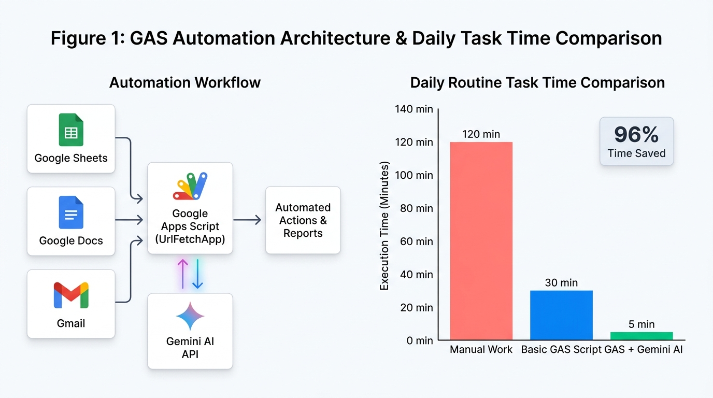

# Introduction to Google Apps Script (GAS)

Google Apps Script (GAS) is basically a coding platform that is provided by Google, and it is made based on the JavaScript language. The most biggest advantage of using GAS is because you can very easily connect and integrate with many various Google apps like Sheets, Docs, and Gmail that we are using every single day to automate boring daily routine works.

First of all, the way to start using GAS is super simple and you totally do not need to install any special softwares on your computer at all. There is a merit that you can immediately start writing code just by opening your web browser.

| Target App | GAS Service | Main Automation Use Case | Task Time |
| :--- | :--- | :--- | :--- |
| Sheets / Docs | `SpreadsheetApp` / `DocumentApp` | Automating daily data aggregation and document creation | 30 min |
| Gemini AI API | `UrlFetchApp` | Calling generative AI for custom business workflow tools | 5 min |

Also, recently it has become possible to call generative AI APIs like Gemini by using UrlFetchApp, so you are able to create your own custom AI tools for your business tasks. Even for beginners of programming, since the learning hurdle is low, trying to use it as a first step of workflow improvement is very recommended.
